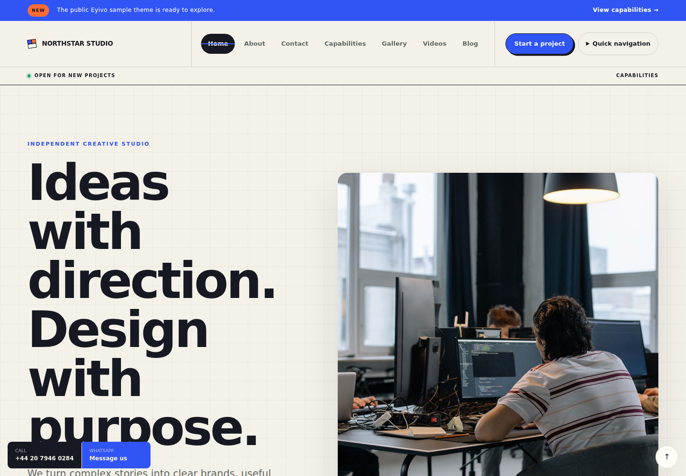
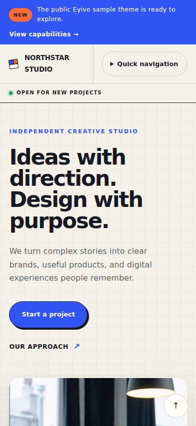
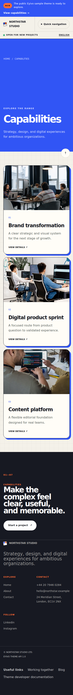
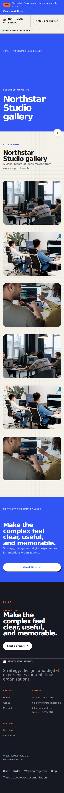
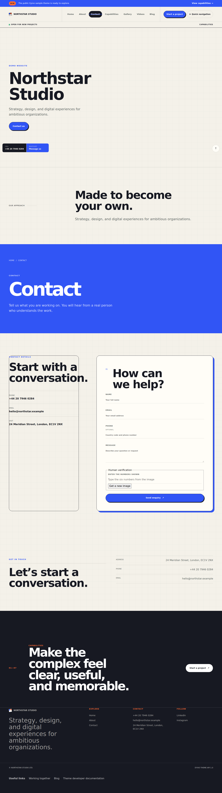

# Eyivo Sample Theme

A complete, self-contained example theme for Eyivo Theme API `1.0`. Use it as a starting point for a custom theme or as a reference while developing one.

## Start here

The theme is the **`sample-theme/`** folder. Everything else in this repository is documentation and an optional helper tool.

1. Download this repository, or use **Download sample theme** under Custom themes in the Eyivo panel.
2. Edit only the files in `sample-theme/`. Raise `version` in `sample-theme/theme.json` every time you upload the same theme again.
3. Zip the `sample-theme` folder. The folder is already a complete package, screenshots included, so no build step is needed.
4. In Eyivo, open **Custom themes** and upload the zip as a **new theme**. For later changes, open that theme and use **Upload a new version**. Then switch each site to the new version (use it as a draft, then publish).

Eyivo gives every uploaded theme its own ID, so the folder name inside your zip and the `key` in `theme.json` don't matter. Unless noted otherwise, the paths below are relative to `sample-theme/`.

## What is included

- A responsive Liquid layout with locale and right-to-left support
- Desktop navigation uses rounded active/hover states with the accent underline below each label
- Home, standard page, gallery, contact, catalog, catalog item, video, blog listing, category, and article page types
- Theme settings and defaults in `theme.json`
- Reusable Eyivo core components declared per content area
- A theme-owned component with editable, translatable fields and variants
- A contact form demonstrating the platform-required Human Verification plugin
- Form bindings for all seven Eyivo form plugins (`contact`, `quote_request`, `product_inquiry`, `appointment`, `course_application`, `reservation`, `property_inquiry`). The Contact page shows the contact form, the home page the quote form, and a Form examples page linked from the footer the other five. Human verification is added to every form automatically, and the Ads plugin needs no theme code, so neither is declared in `theme.json`.
- Main navigation shows five links and moves the rest into a More menu built with `<details>`, so it works without JavaScript
- Hero backgrounds on every page except policy pages: page hero images, and on listings the first gallery photo, product cover, video poster or post cover
- Responsive CSS and package-local image/font assets (custom JavaScript is disabled in Theme API v1)
- Demo metadata in `demo.json`
- Desktop and mobile screenshots from a real seeded Eyivo site

See [FEATURES.md](FEATURES.md) for the complete coverage matrix.

## Required screenshot policy

Every theme upload must include `demo.json` and at least one screenshot captured
after loading that demo data. Save each capture in `preview/` and declare it in
`theme.json` under `preview`, with `data_source` set to `demo_data`, its
`preview/` path, page, and viewport. `source_path` is optional and defaults to
the same file. The app panel rejects packages without this declaration or its
preview image.

## Screenshots

| Desktop | Mobile |
| --- | --- |
| [](sample-theme/preview/home-desktop.png) | [](sample-theme/preview/home-mobile.png) |
| [](sample-theme/preview/catalog-desktop.png) | [](sample-theme/preview/catalog-mobile.png) |
| [](sample-theme/preview/gallery-desktop.png) | [](sample-theme/preview/gallery-mobile.png) |
| [](sample-theme/preview/contact-desktop.png) | [](sample-theme/preview/contact-mobile.png) |

Additional views: [About](sample-theme/preview/about-desktop.png), [catalog detail](sample-theme/preview/catalog-detail-desktop.png), [videos](sample-theme/preview/videos-desktop.png), [page body](sample-theme/preview/page-body-desktop.png), [Footer desktop](sample-theme/preview/footer-desktop.png), [Footer mobile](sample-theme/preview/footer-mobile.png), and [mobile navigation](sample-theme/preview/navigation-mobile.png).

## Directory structure

```text
eyivo-sample-theme/               repository
├── README.md
├── FEATURES.md
├── FOUNDATION-COMPOSITION.md
├── LICENSE
├── bin/
│   └── eyivo-theme               optional helper: validate, pack, init
└── sample-theme/                 the theme: edit, zip and upload this folder
    ├── assets/
    │   └── css/
    │       ├── base.css
    │       └── theme.css
    ├── components/
    │   └── capability_note.liquid
    ├── layouts/
    │   └── default.liquid
    ├── page-types/
    │   ├── contact.liquid
    │   ├── gallery.liquid
    │   ├── home.liquid
    │   ├── page.liquid
    │   ├── product.liquid
    │   ├── products.liquid
    │   ├── videos.liquid
    │   ├── blog.liquid
    │   ├── blog_category.liquid
    │   └── blog_post.liquid
    ├── locales/
    │   ├── en.json
    │   └── tr.json
    ├── preview/                  demo-data screenshots
    ├── demo.json
    └── theme.json
```

The theme uses the full built-in `eyivo:*` component library and includes `theme:capability_note` as an example of a theme-owned component. Its schema, defaults, translations, and variants are declared under `components` in `theme.json`. Theme API v1 intentionally disables custom JavaScript and external assets; interactive platform features remain platform-owned.

### Event listings

Add `eyivo:event_list` to a home or standard page area for responsive event cards. Set the section `eyebrow`, `heading`, `intro`, and an `items` repeater. Each item can provide `date_label`, `category`, `title`, `summary`, `location`, `image_url`, `image_alt`, `url`, and `link_label`. The card link uses the site's localized URL handling. Upload images through Eyivo and use their public URLs; include meaningful alt text.

This is a presentation component. Dates and locations are editor-managed text, and the component does not create event records, booking forms, tickets, or calendar feeds. The three included demo entries are clearly marked examples without confirmed dates; their decorative images reuse public URLs already declared in `demo.json` media. The demo includes a navigable `/events` page alongside its homepage event section. Describe meaningful photographs with `image_alt` when replacing the examples.

The header uses native `<details>` navigation on desktop and mobile. Back-to-top is an ordinary fragment link. `show_color_mode` enables the visitor's system dark/light preference through CSS; the sample does not save a separate color preference or provide client-side navigation filtering.

## Customize the theme

1. Change the name and semantic version in `theme.json`.
2. Keep `eyivo_theme_api` set to a supported API version.
3. Define editable theme settings under `settings` and their initial values under `defaults`.
4. Edit the Liquid files in `layouts` and `page-types`.
5. Add styles and permitted package-local assets under `assets`.
6. Increment the theme version before uploading a new version of the same theme.

User-facing static text in Liquid should use the translation filter:

```liquid
{{ "Contact us" | t }}
```

Internal URLs from theme settings should use `localized_url`:

```liquid
{{ theme.settings.header_cta_url | localized_url }}
```

## Plugins and forms

Themes control form placement, layout and styling. Approved system plugins define accepted fields, validation and workflow; Eyivo stores submissions independently of the active theme.

This sample targets Theme API `1.0`, Forms API `1` and the system form-plugin release. The Contact plugin is declared in `theme.json`, together with portable aliases:

```json
{
  "plugins": ["eyivo/contact"],
  "forms": {
    "contact": {"plugin": "eyivo/contact", "type": "contact", "schema_version": 1, "instance": "default"}
  }
}
```

Installing the plugin creates a persistent form UUID automatically. Reusing its binding on different pages reuses that form's settings and inbox history. Rendering does not create a form. Theme changes, plugin updates and reinstallations retain form identity and submitted answers. Never put a site's UUID, submissions or credentials in a distributable theme or demo.

### Rendering a form

The [contact template](page-types/contact.liquid) resolves `forms.contact` and loops over its normalized `fields`. Preserve the runtime action, CSRF input, encrypted `form_context`, honeypot, field names, validation feedback and `data-eyivo-submission` attribute. Field definitions supply localized labels and placeholders/help; style their controls using theme CSS.

Use `{{ form.verification_html | raw }}` inside the form before its submit button. This is trusted platform markup, never visitor input. Do not reuse the old `contact.action` object or hardcode a submission endpoint. Only server-produced HTML uses `raw`; leave labels, values and errors escaped.

Reusable sections use the core component:

```liquid

```

The section editor offers declared defaults and compatible named forms as a selector. A separate named form gets its own UUID automatically. Use separate component placements when displaying the same form multiple times on one page so tokens and feedback remain independent.

Optional `forms.<alias>.settings.presentation` overrides permitted labels, placeholders, help and order. `additional_fields` must use the plugin's declared supported scalar types and complete field definitions. The assigned master validates and stores these during authorized publication. Themes cannot weaken plugin-required fields or reinterpret an existing field's type.

### Verification and saving

Human Verification is required through the form plugin's dependency. The platform renders one localized challenge per form placement and loads registered scripts/styles under the custom-theme CSP. Keep `eyivo_head`; do not include plugin source, custom JavaScript or external verification scripts.

The tenant server talks to `plugins.eyivo.com/verification/*`; browsers use the tenant's context-bound challenge endpoint. Theme authors do not deploy or configure that backend. Its bearer, keys and database credentials do not belong in theme files.

Success means the submission was saved. Repeated clicks and identical retries reuse the submission attempt, independently of verification's abuse protection. Email is delivered afterward and retries separately. The customer's shared inbox and the form plugin's mandatory list/detail pages display the same records. Authorized account members can view them; other customer accounts cannot.

Submissions consume the site's existing package database allowance. No separate form-submission count or retention quota is introduced. Plugin configuration limits do not cap submission history.

### Validate on the platform

1. Install/reconcile the required plugin and default form before publishing. An unavailable form shows an explicit message, not a functioning-looking empty form.
2. Check desktop/mobile, keyboard navigation and non-English/RTL labels, guidance, field errors and success next to the submitting placement.
3. Test missing/incorrect verification and valid submission on a staging tenant. Confirm the shared inbox and plugin-specific pages show the same record.
4. Reuse a form on another page and switch between compatible themes. Its UUID/history must remain unchanged, while source attribution identifies the actual page.
5. Keep the preview screenshots representative of the current rendered theme; the no-script upload preview cannot complete human verification.

Plugin packages and PHP handlers remain separate from theme archives. Public submission records live in the assigned site's content database, not the shared verification-service database. Neither themes nor plugins receive direct database access.

## Package for upload

Zip the `sample-theme` folder and upload the zip. A zip of the folder itself and a zip of its contents are both accepted, because Eyivo ignores one wrapping folder.

The optional helper checks the theme before you upload and can build the zip for you. It needs PHP 8.1 or later on your computer:

```bash
php bin/eyivo-theme validate sample-theme
php bin/eyivo-theme pack sample-theme ../eyivo-sample-theme.zip
php bin/eyivo-theme init ../my-eyivo-theme
```

`init` copies `sample-theme/` to a new folder as a starting point for your own theme.

Upload the zip from:

```text
App Panel → Custom themes → Upload a new theme
App Panel → Custom themes → (your theme) → Upload a new version
```

Do not copy this project into the built-in themes directory. Upload it through the Custom Themes library so it follows the same validation, node warmup, preview, Branding draft, and publication path as every user theme.

## Demo data

`demo.json` is a complete Northstar Studio fixture: company profile, theme
settings, pages and components, catalog content, a gallery, videos, and public
media references. New dashboard sites publish the selected demo immediately unless
the owner disables demo content during creation. Importing from Branding on an
existing site still creates drafts for review. The central app copies media, so
this repository contains no object-storage credentials.

## Demo data format

The included `demo.json` uses Theme API schema version `2`:

| Key | Purpose |
| --- | --- |
| `default_locale` | Always `en`; omitted in legacy fixtures also means English. |
| `media` | Public source URLs and metadata, keyed by portable asset identifiers. |
| `company` | Company profile, brand colors, optional logo/favicon assets, and translations. |
| `theme_settings` | Initial theme settings and optional translations. |
| `pages` | Page type, SEO, navigation, components, and locale-keyed content. |
| `catalog` | Catalog entries with an optional `cover_asset`. |
| `galleries` | Gallery metadata and image items; every item needs `asset` and `alt_text`. |
| `blog_posts` | Locale-keyed article documents; images use portable media_asset references. |
| `menus` | Ordered additional-menu drafts using source slugs and optional locale-keyed slugs. |
| `videos` | External `source_url` or a packaged-media reference. |

Use relative URLs such as `/contact` for links inside the demo site. A media
reference must have a public `public_url`; Eyivo downloads and stores it through
the central application during demo import. Never include tenant IDs, R2/S3
credentials, or direct storage-write instructions.

See the complete working structure in this repository's [`demo.json`](demo.json).

## Security

Do not put credentials, private keys, environment files, or tenant data in a theme. Theme archives are treated as untrusted input and must pass platform validation before they can be previewed or activated.

## License

MIT. See [LICENSE](LICENSE).

## Blog support

Free blogs support flat categories, multiple categories per post, cover and inline images, translated rich text, draft previews, and scheduled publication. Use `blog`, `blog_category`, and `blog_post` page types with the `blog` Liquid object. Only server-produced `blog.post.body_html` should use `raw`. Omitted blog types inherit core templates inside the active layout. `eyivo_head` supplies responsive blog and bounded card-image styles. Manual imports stage blog drafts; new-site demo creation publishes them immediately.

## Registered menus

Main navigation remains automatic: the page editor's **Show in navigation** option
and the platform's listing rules populate navigation.main. This sample also
registers footer and useful_links in theme.json. Their labels, descriptions,
and translations describe the locations users can select in content editors.

    
    <nav aria-label="{{ 'Useful links' | t }}">
      
        <a href="{{ item.url }}" aria-current="page">{{ item.label }}</a>
      
    </nav>
    

Each advertised menu must actually be rendered. An empty menu stays empty.
Membership and order are shared across languages; labels and destination URLs
are localized, and unpublished translations are omitted. Additional menus can
contain pages, posts, products, galleries, videos, listing destinations, and
custom links. They are flat lists, not dropdown trees.

Saving content stages its menu selections; publishing that content applies only
those selections. The Menus screen saves and publishes its own drafts. Theme
switches retain unsupported menu assignments as inactive. The sample demo imports
menu drafts using source slugs and requires explicit publication.

The initialize_from_main option is a one-time compatibility seed used by Footer.
It does not keep the menus linked. Useful links starts empty unless its demo
assignments are imported. Demo blog_posts contains locale-keyed article drafts;
demo menus contains ordered entries using type plus slug, listing, or custom URL.

## Rich text and page links

The page and product types explicitly declare uses_body: true. Core rich_text,
image_text, and this sample's capability-note text use the platform rich-text
editor. The editor supplies formatting, images, and a searchable page-link picker.
URL fields also support page references.

Keep page.body and rich-text component fields escaped in Liquid. Eyivo expands
its editor markers through a server-side allow-list after rendering; do not add
raw to user-authored fields. In contrast, blog.post.body_html is already
server-rendered and sanitized HTML and is intentionally rendered with raw.

Picker references are site-owned IDs resolved to the published destination in
the visitor's language. Renaming a slug keeps those references working. A missing,
deleted, or unpublished destination becomes an unavailable link. Do not put
another site's page IDs in a demo; use portable source slugs for menu fixtures.

The sample adds no editor JavaScript or storage credentials. Platform-owned
editors, plugins, and media delivery supply those capabilities.

Version 1.3.0 previews include a generic page-body example, independent Footer links, and keyboard-operated mobile quick navigation. The stable design class also works with platform-assigned custom theme keys.

### Ads in rich-text fields

The optional Ads plugin (`eyivo/monetization`) needs no theme code. Site owners
save their ad network's code as ad slots and choose a slot above any rich-text
field, including multi-line fields of items they add to a section. The field's
text is kept and returns when the owner chooses Text again.

- Do not declare `eyivo/monetization` in `theme.json`; owners install it from
  the Plugins page.
- Render rich-text fields escaped, as above. Eyivo replaces a bound field after
  rendering. When the field is the only content of its element, the whole
  element is replaced, so give each rich-text field its own element, as
  `capability_note.liquid` does with
  `<div class="prose capability-note-body">{{ component.data.text }}</div>`,
  and do not rely on that element's styles around an ad.
- Ads run only on the owner's own domain. Previews show a grey box with the
  slot's name; the Eyivo address shows the field's text.
- Theme files stay subject to the custom-theme CSP. Eyivo relaxes the script
  rule only on pages showing a live ad, for the owner's ad code.
- Never put ad code, slot IDs or `_ads` bindings in `demo.json`.

## Optional demo translations

English is the required base of demo.json. The fixture declares `default_locale: "en"`
and provides English and Turkish content. Other languages are optional; do not create
fake translations by copying English into every locale. Supported site locales are
`en`, `tr`, `de`, `fr`, `es`, `it`, `pt`, `nl`, `pl`, `ar`, `ru`, `ja`, `ko`, and `zh`.
These content translations are separate from the theme UI dictionaries in `locales/`.

Creating a Turkish site selects `translations.tr`; a missing field falls back to
`translations.en`, then a legacy unkeyed English field. Arrays such as component
items and article documents replace the whole English value, while explicit empty
values stay empty. Only the site's selected native language is imported; the presence
of other fixture translations does not enable those site languages automatically.

Company copy, theme settings, page bodies and SEO, components, products, galleries,
gallery-item titles/captions/alt text, videos, and blog documents follow this rule.
Keep shared media asset keys and component structure outside the translation map.

```json
{
  "type": "contact",
  "translations": {
    "en": { "slug": "contact", "title": "Contact", "body": "Tell us about your project." },
    "tr": { "slug": "iletisim", "title": "İletişim", "body": "Projenizden bahsedin." }
  }
}
```

Use English source URLs such as `/contact` in demo links. Import maps them to the
selected slug, such as `/iletisim`, including rich-text and blog-document links.
The English homepage source `/home` resolves to `/`. Portable menu entries reference
source slugs, with optional `slugs` and `labels` maps; English label overrides provide
the fallback. External URLs are unchanged. The sample Footer and Useful links menus
include explicit English/Turkish slug maps to demonstrate portable references.

`php bin/eyivo-theme validate` checks the English baseline, supported locale keys,
translation object shapes, and `default_locale`. Older unkeyed English content is
still accepted. A demo export retains all available translations, including gallery
image descriptions, and rejects content without an English title and slug.
