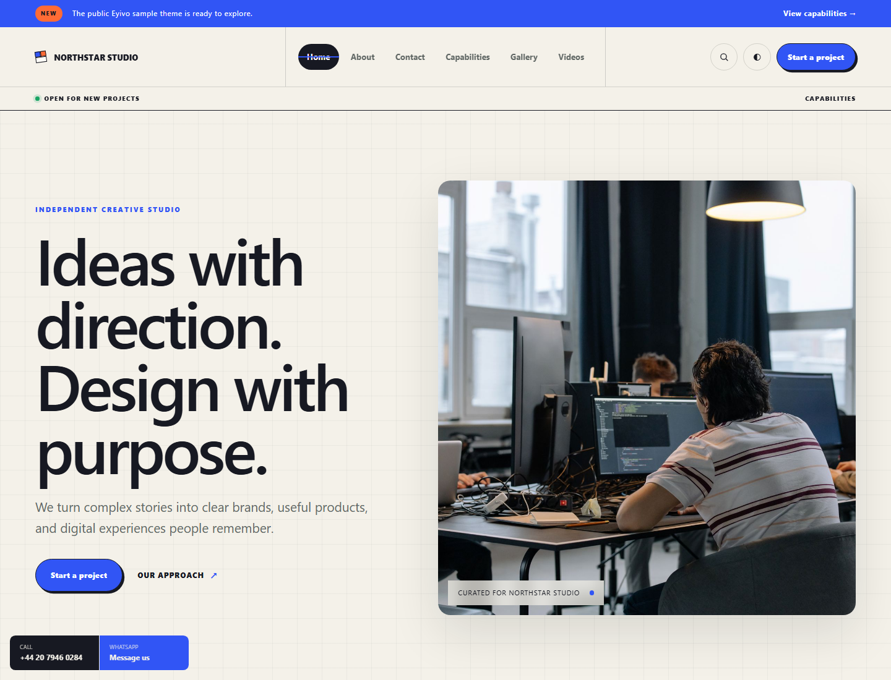
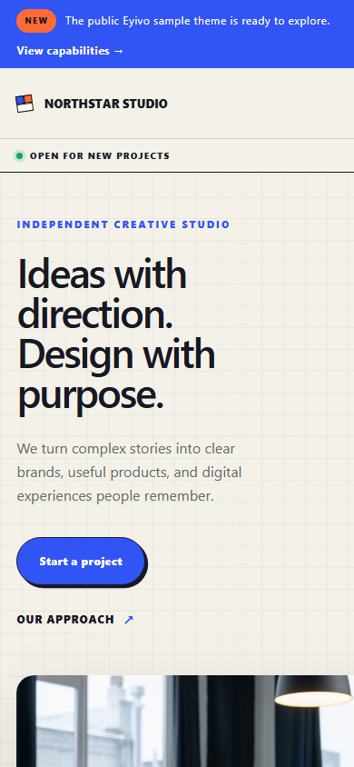
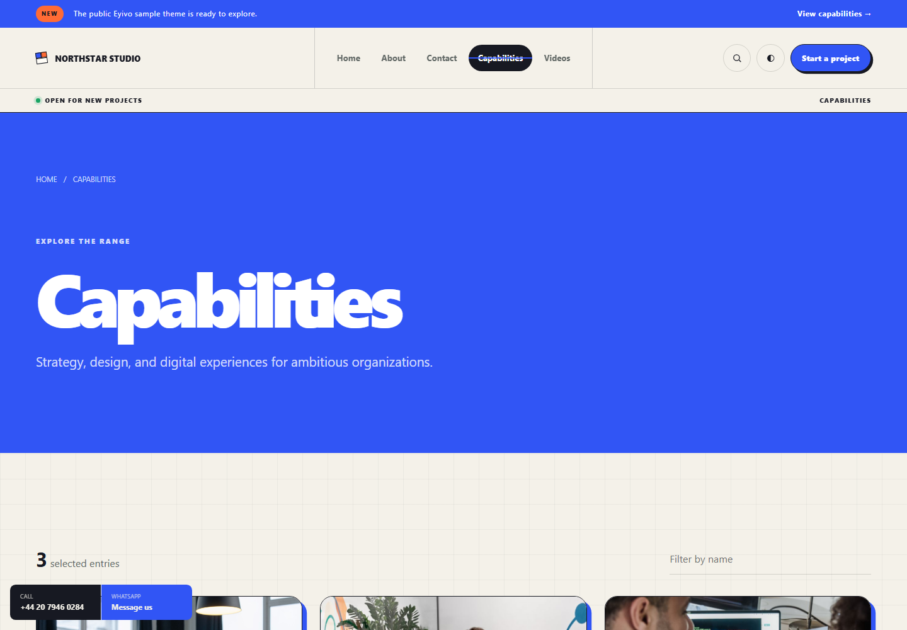
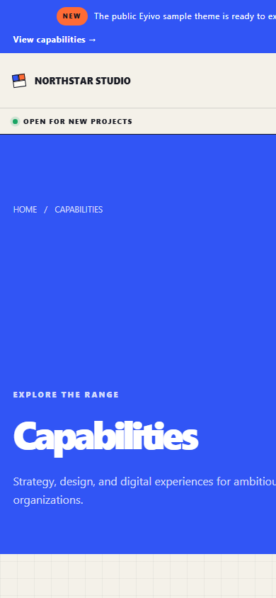
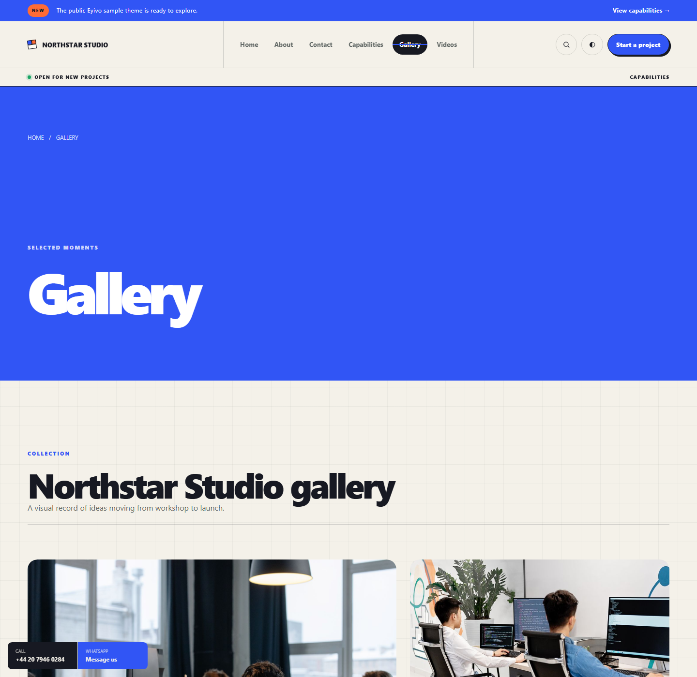
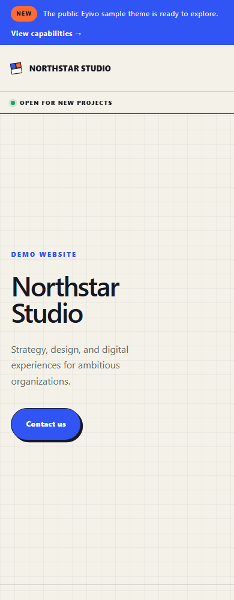

# Eyivo Sample Theme

A complete, self-contained example theme for Eyivo Theme API `1.0`. Use it as a starting point for a custom theme or as a reference while developing one.

## What is included

- A responsive Liquid layout with locale and right-to-left support
- Home, standard page, gallery, contact, catalog, catalog item, and video page types
- Theme settings and defaults in `theme.json`
- Reusable Eyivo core components declared per content area
- A theme-owned component with editable, translatable fields and variants
- CSS and JavaScript assets
- Demo metadata in `demo.json`
- Desktop and mobile screenshots from a real seeded Eyivo site

See [FEATURES.md](FEATURES.md) for the complete coverage matrix.

## Screenshots

| Desktop | Mobile |
| --- | --- |
| [](screenshots/home-desktop.png) | [](screenshots/home-mobile.png) |
| [](screenshots/catalog-desktop.png) | [](screenshots/catalog-mobile.png) |
| [](screenshots/gallery-desktop.png) | [](screenshots/gallery-mobile.png) |
| [](screenshots/contact-desktop.png) | [](screenshots/contact-mobile.png) |

Additional views: [About](screenshots/about-desktop.png), [catalog detail](screenshots/catalog-detail-desktop.png), and [videos](screenshots/videos-desktop.png).

## Directory structure

```text
sample-theme/
├── assets/
│   ├── css/
│   │   ├── base.css
│   │   └── theme.css
│   └── js/
│       └── theme.js
├── components/
│   └── capability_note.liquid
├── layouts/
│   └── default.liquid
├── page-types/
│   ├── contact.liquid
│   ├── gallery.liquid
│   ├── home.liquid
│   ├── page.liquid
│   ├── product.liquid
│   ├── products.liquid
│   └── videos.liquid
├── screenshots/
├── demo.json
├── FEATURES.md
└── theme.json
```

The theme uses the full built-in `eyivo:*` component library and includes `theme:capability_note` as an example of a theme-owned component. Its schema, defaults, translations, and variants are declared under `components` in `theme.json`.

## Customize the theme

1. Change the name and semantic version in `theme.json`.
2. Keep `eyivo_theme_api` set to a supported API version.
3. Define editable theme settings under `settings` and their initial values under `defaults`.
4. Edit the Liquid files in `layouts` and `page-types`.
5. Add styles and behavior under `assets`.
6. Increment the theme version before uploading a new release.

User-facing static text in Liquid should use the translation filter:

```liquid
{{ "Contact us" | t }}
```

Internal URLs from theme settings should use `localized_url`:

```liquid
{{ theme.settings.header_cta_url | localized_url }}
```

## Package for upload

Create a ZIP whose archive root contains `theme.json`; do not place all theme files inside an additional parent directory.

PowerShell example:

```powershell
Compress-Archive -Path assets,components,layouts,page-types,demo.json,theme.json -DestinationPath eyivo-sample-theme-1.0.0.zip
```

When custom-theme uploads are enabled, upload that archive from:

```text
App Panel → Custom Themes → Upload Theme
```

For local platform development, copy this directory to `sites/themes/sample-theme` and register `sample-theme` as a selectable template in the site configuration.

## Demo data

`demo.json` supplies the Northstar Studio demo identity recognized by Theme API `1.0`. Applying demo content creates editable draft pages, components, catalog content, a gallery, and a video; review each resource before publishing.

## Security

Do not put credentials, private keys, environment files, or tenant data in a theme. Theme archives are treated as untrusted input and must pass platform validation before they can be previewed or activated.

## License

MIT. See [LICENSE](LICENSE).
